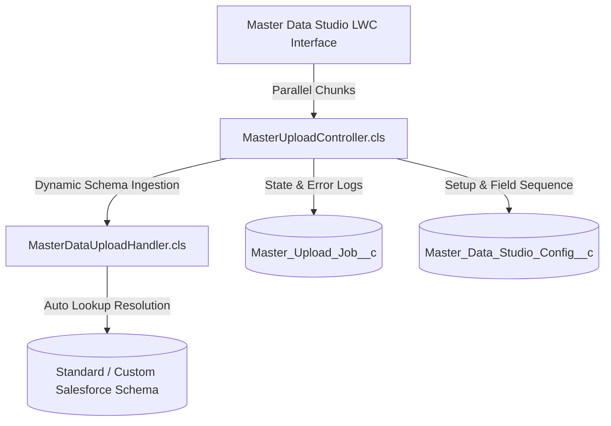

# 🚀 Master Data Studio for Salesforce

[](https://login.salesforce.com/packaging/installPackage.apexp?p0=04tg8000000Uguf)
[](https://test.salesforce.com/packaging/installPackage.apexp?p0=04tg8000000Uguf)

[](https://developer.salesforce.com/)
[](https://developer.salesforce.com/docs/component-library/overview/components)
[](https://developer.salesforce.com/docs/atlas.en-us.apexcode.meta/apexcode/apex_testing.htm)
[](https://opensource.org/licenses/MIT)

**Master Data Studio** is a 100% dynamic, metadata-driven, enterprise-grade Master Data Management & Upload platform built natively on Salesforce with Lightning Web Components (LWC) and Apex.

It empowers business users and administrators to configure, validate, template, and upload master records across **any Standard or Custom Salesforce Object** with hierarchical parent lookup resolution, parallel batch processing, live progress tracking, and instant error report generation.

---

## 📦 1-Click Package Installation

Install directly into your Salesforce environment using the buttons below:

| Environment | 1-Click Installation Link |
| :--- | :--- |
| **Production / Developer Edition** | [👉 Install in Production / Developer Org](https://login.salesforce.com/packaging/installPackage.apexp?p0=04tg8000000Uguf) |
| **Sandbox** | [👉 Install in Sandbox Org](https://test.salesforce.com/packaging/installPackage.apexp?p0=04tg8000000Uguf) |

### Install via Salesforce CLI:
```powershell
sf package install --package 04tg8000000Uguf -w 20 -o MyTargetOrg
```

> **Post-Install Step:** Assign the **Master Data Studio Admin** permission set to your admin users to grant access to the App, Tab, and Custom Objects.
> ```powershell
> sf org assign permset -n Master_Data_Studio_Admin -o MyTargetOrg
> ```

---

## ✨ Key Highlights

- 🔄 **100% Dynamic Schema Discovery**: Zero hardcoded objects. Works out-of-the-box for any Standard object (`Account`, `Contact`, `Opportunity`, etc.) or custom business object.
- ⚡ **Parallel Multi-Job Processing**: Execute up to 3 upload jobs simultaneously in isolated threads with real-time percentage indicators.
- 💾 **Persistent State**: Refreshing or navigating away never loses upload state. Active jobs and their progress reload seamlessly from Salesforce.
- 📥 **Dynamic CSV Template Generator**: Automatically generates sample CSV templates containing active fields, picklist hints, and lookup references directly from your schema.
- 🔗 **Smart Foreign Key Resolution**: Automatically queries and resolves parent record IDs by External Code or Name during ingestion.
- ❌ **Instant Error Isolation & Download**: Download a pre-formatted CSV containing only failed rows along with exact error reasons for easy correction and re-upload.
- 🛡️ **Zero External Dependencies**: Test suite runs on standard Salesforce schema, guaranteeing 100% test pass rate in any fresh packaging org, developer edition, or subscriber org.

---

## 🏗️ Architecture



---

## 📦 What's Included in the Package

| Component Type | Component Name | Description |
| :--- | :--- | :--- |
| **Lightning Component** | `masterDataUpload` | Modern reactive UI for Setup, Upload, Parallel Progress & Error Logs |
| **Apex Controller** | `MasterUploadController` | Handles UI wire calls, metadata describes, job lifecycle & limits |
| **Apex Handler** | `MasterDataUploadHandler` | High-performance bulk DML engine with type conversions & lookup resolution |
| **Apex Tests** | `MasterUploadControllerTest`, `MasterDataUploadHandlerTest` | 23 comprehensive unit tests (89% coverage, 0 custom object dependencies) |
| **Custom Object** | `Master_Data_Studio_Config__c` | Stores object sequence, external ID keys, and selected field definitions |
| **Custom Object** | `Master_Upload_Job__c` | Stores upload job state, row counts, progress %, and error JSON logs |
| **Custom Tab** | `Master_Data_Studio` | Lightning App Tab for the studio |
| **Permission Set** | `Master_Data_Studio_Admin` | Administrative permissions to configure and operate the studio |

---

## 🛠️ How It Works

### 1. Visual Object Setup
1. Open the **Master Data Studio** tab.
2. Click **Add Object to Setup**.
3. Choose any Standard or Custom Object from the dynamic dropdown.
4. Select the External ID / Matching Key field.
5. Choose the fields you want to include in the upload template.
6. Click **Save Configuration**.

### 2. Download Template
- Click on any configured object card to view field definitions, data types, and lookup details.
- Click **Download CSV Template** to get an auto-generated sample file.

### 3. Parallel Upload & Monitoring
- Drag and drop your CSV file.
- The studio splits records into optimized chunks and streams them through Apex.
- Monitor active jobs in parallel (up to 3 concurrent slots).
- View live success / failure counts.
- If any row fails, click **Download Error File** to review the exact line numbers and reasons.

---

## 💻 Source Deployment (Optional for Developers)

If you prefer deploying from source instead of installing the package:

```powershell
# 1. Authorize your target Salesforce Org
sf org login web -a MyTargetOrg

# 2. Deploy Master Data Studio metadata
sf project deploy start -d force-app -o MyTargetOrg

# 3. Assign Permission Set
sf org assign permset -n Master_Data_Studio_Admin -o MyTargetOrg
```

### Run Apex Tests
```powershell
sf apex run test --class-names MasterDataUploadHandlerTest MasterUploadControllerTest --result-format human --code-coverage -o MyTargetOrg
```

---

## 📄 License
This project is licensed under the MIT License - see the [LICENSE](LICENSE) file for details.
